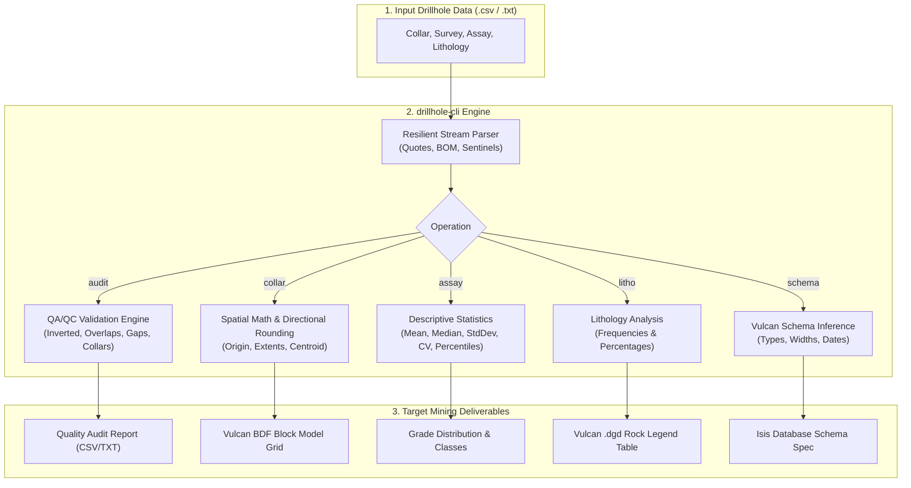

<div align="center">


**High-performance mining data engineering & QA/QC validation CLI for Maptek Vulcan**

[](https://www.npmjs.com/package/@luicciandev/drillhole-cli)
[](https://nodejs.org)
[](https://www.typescriptlang.org)
[](LICENSE)
[](https://github.com/natemoo-re/clack)
[](https://www.maptek.com/products/vulcan/)
[](https://pnpm.io)

[Installation](#installation) • [Quick Start](#quick-start) • [Features](#features) • [Workflow](#workflow) • [Commands](#commands) • [Examples](#examples) • [Exports](#exports) • [Interactive Mode](#interactive-mode) • [Development](#development)

</div>

`@luicciandev/drillhole-cli` is a high-performance command-line tool built for exploration geologists, resource estimation geologists, and mining data technicians. It processes drillhole datasets (`.csv`, `.txt`) using Node.js streaming I/O to perform automated QA/QC data validation, descriptive assay statistics, lithological code distributions, and spatial boundary calculations formatted specifically for **Maptek Vulcan** (including Isis, GeologyCore, and Block Definition Files `.bdf`).

---

## Quick Start

```bash
# 1. Install globally
npm install -g @luicciandev/drillhole-cli

# 2. Audit drillhole file for errors (overlaps, gaps, inverted intervals)
drill audit ./data/assays.txt

# 3. Calculate collar limits & Vulcan block model (.bdf) boundaries
drill collar ./data/collar.csv -b 50 -f csv

# 4. Generate assay statistics (mean, median, CV, percentiles)
drill assay ./data/assays.txt -c 8

# 5. Or launch the interactive terminal wizard
drill
```

---

## Features

- **Geological QA/QC & Integrity Engine (`audit`)**:
  - Automatically identifies file type: `COLLAR`, `INTERVAL`, `LITHO`, or `GENERIC`.
  - Flags inverted intervals where $FROM \ge TO$ (`CRITICAL`).
  - Detects overlapping downhole intervals for the same drillhole ($FROM_i < TO_{i-1}$, `WARNING`).
  - Highlights un-sampled gaps and missing runs ($FROM_i > TO_{i-1}$, `INFO`).
  - Identifies duplicate hole IDs in collar files and invalid or origin `(0,0)` coordinates (`CRITICAL`).
  - Recognizes mining sentinel codes (`-999`, `-99`, `NA`) and physically impossible percentage grades ($> 100\%$, `WARNING`).
- **Vulcan Block Model Framework (`collar`)**:
  - Implements **directional rounding** (floor for minimums, ceil for maximums) to align with parent block grids.
  - Automatically factors in drillhole total depth (`LENGTH`) to enclose the deposit at depth.
  - Computes complete Vulcan `.bdf` parameters: **Origin** $(X_{min}, Y_{min}, Z_{min})$, **Extents** $(\Delta X, \Delta Y, \Delta Z)$, and **Centroid** $(X_c, Y_c, Z_c)$.
- **Descriptive Grade Statistics (`assay`)**:
  - Excludes sentinel/missing codes (`-999`, `-99`, `NA`) so statistical distributions reflect true grades.
  - Calculates Mean ($\mu$), Median ($P_{50}$), Standard Deviation ($\sigma$), Variance ($\sigma^2$), and Coefficient of Variation ($CV = \sigma / \mu$).
  - Produces customizable percentile class ranges with exact sample counts and percentage breakdowns.
- **Lithology Frequency & Legend (`litho`)**:
  - Extracts unique rock and alteration codes with occurrence counts and dataset percentages for Vulcan `.dgd` legend generation.
- **Vulcan Schema Type Inference (`schema`)**:
  - Infers Vulcan database field data types: `integer`, `single`, `double`, `text`, and date formats (`YYYY-MM-DD`).
- **Resilient & Dynamic Parser**:
  - Constant $O(1)$ memory consumption via Node.js streams; handles multi-million-row drillhole dumps effortlessly.
  - Parses CSV fields containing internal commas within double quotes (e.g. `"Breccia, silicified"`).
  - Automatically strips UTF-8 BOM (`\uFEFF`) from Excel exports.
  - Dynamic file path resolution: pass `./data/assays.txt` directly without separating `--dir` and `--file`.
  - Smart auto-detection: running `drill collar` without arguments automatically searches for matching collar files in the working directory or subfolders (`data/`, `data_tests/`).
  - Typo suggestions: typing `drill colr` suggests `Did you mean "collar"?`.
- **Universal Exporter**:
  - Exports structured CSV and human-readable TXT files into `./exports/` with non-destructive timestamps.

---

## Workflow



---

## Installation

```bash
npm install -g @luicciandev/drillhole-cli
```

Verify installation:

```bash
drill --version
drill --help
```

---

## Commands

```bash
drill <command> [file-path] [options]
```

### Primary Subcommands

| Subcommand      | Description                                                                                 |
| --------------- | ------------------------------------------------------------------------------------------- |
| `audit [file]`  | Run geological database QA/QC (validates intervals, overlaps, gaps, collars, and sentinels) |
| `collar [file]` | Compute spatial boundaries and Vulcan Block Model Framework (`.bdf`) origin and extents     |
| `assay [file]`  | Generate descriptive grade statistics ($\mu, P_{50}, \sigma, CV$) and percentile classes    |
| `litho [file]`  | Generate unique lithological code legend with sample counts and relative percentages        |
| `schema [file]` | Infer Maptek Vulcan field types (`integer`, `single`, `double`, `text`, `date`)             |

### Options & Short Flags

| Option                | Short           | Description                                                                                           |
| --------------------- | --------------- | ----------------------------------------------------------------------------------------------------- |
| `[file-path]`         | (positional)    | Direct path to target file (e.g. `./data/collar.csv` or `assays.txt`). Auto-resolves folder and file! |
| `--buffer <num>`      | `-b <num>`      | Additional spatial buffer distance for collar boundaries (default: `0`)                               |
| `--classes <num>`     | `-c <num>`      | Number of percentile classes for assay grade analysis (default: `6`)                                  |
| `--format <csv\|txt>` | `-f <csv\|txt>` | Export format (saved into `./exports/` or `--outdir`)                                                 |
| `--outdir <path>`     | `-o <path>`     | Custom export output directory (default: `./exports/`)                                                |
| `--cols <c1,c2,...>`  |                 | Comma-separated list of target columns for assay or lithology                                         |
| `--no-banner`         | `-q`            | Suppress startup ASCII banner (recommended for scripts and AI agents)                                 |
| `--dir <path>`        | `-d <path>`     | Optional directory override (not needed when passing file path)                                       |
| `--file <name>`       |                 | Optional explicit file name                                                                           |

> [!TIP]
> **No `--dir` or `--file` Required**:
> You can pass the file path directly (e.g. `drill collar ./data/collar.csv -b 50`). If you omit the file path entirely, the CLI intelligently scans the current folder and subfolders (`data/`, `data_tests/`) for the best matching file.

---

## Examples

### 1. Geological Database Audit & QA/QC

Validate downhole intervals or collar files to detect geological inconsistencies:

```bash
drill audit ./project-data/assays.txt -q
```

```text
=== GEOLOGICAL AUDIT & QA/QC REPORT ===
Detected File Type : INTERVAL
Total Rows         : 26944
Total Columns      : 5
Total Nulls        : 0
Numeric Cols       : 4

Findings Summary:
  ✖ CRITICAL : 0
  ⚠ WARNING  : 0
  ℹ INFO     : 0

✔ No se detectaron anomalías ni inconsistencias geológicas en este archivo.
```

When errors or anomalies are found, they are reported with specific row and hole IDs:

```text
Detailed Findings (sample):
  ✖ [CRITICAL] Fila 3 | Pozo: DH01 | Col: FROM / TO -> Intervalo invertido o nulo: FROM (15) >= TO (10)
  ⚠ [WARNING]  Fila 5 | Pozo: DH02 | Col: FROM / TO -> Solapamiento de intervalos: tramo (8-20) se solapa con previo (0-10)
  ℹ [INFO]     Fila 6 | Pozo: DH02 | Col: CUT%      -> Código centinela minero '-999' detectado en columna numérica
```

Export the findings report directly to CSV:

```bash
drill audit ./project-data/assays.txt -f csv -q
```

---

### 2. Collar Limits & Vulcan Block Model (`.bdf`) Framework

Calculate bounding box extents and origin coordinates for Vulcan block modeling:

```bash
drill collar ./project-data/header.txt -b 50 -f csv -q
```

```text
=== COLLAR LIMITS & SPATIAL EXTENTS ===

EASTING (X):
  raw         : [474460.02, 474961.58]
  min_boundary: 474350
  max_boundary: 475050

NORTHING (Y):
  raw         : [4479648.12, 4480124.94]
  min_boundary: 4479550
  max_boundary: 4480250

ELEVATION (Z):
  raw_elev    : [621.1, 656]
  max_length  : 1013 (LENGTH)
  min_boundary: -405  (MIN_ELEV - MAX_LENGTH, redondeo decena)
  max_boundary: 665  (MAX_ELEV, redondeo decena)

=== VULCAN BLOCK MODEL FRAMEWORK (.bdf) ===
  Origin (X, Y, Z)   : (474350, 4479550, -405)
  Extents (DX, DY, DZ): 700m x 700m x 1070m
  Centroid (Xc, Yc, Zc): (474700, 4479900, 130)
```

> [!NOTE]
> Directional rounding aligns spatial boundaries with parent block grids:
>
> - Minimum coordinates are floored to the nearest 100m (or 10m for elevation).
> - Maximum coordinates are ceiled to the nearest 100m (or 10m for elevation).
> - Elevation automatically incorporates maximum downhole length (`LENGTH`) to enclose the deposit at depth.

---

### 3. Assay Descriptive Statistics & Percentile Classes

Analyze assay grade distributions with clean sentinel handling:

```bash
drill assay ./project-data/assays.txt --cols "CUT%" -c 6 -q
```

```text
=== ASSAY GRADE & STATISTICAL ANALYSIS ===

Variable: CUT%
  Rango Raw    : [0, 26.2]
  Muestras     : 26944 válidas
  Media (μ)    : 0.6203
  Mediana (P50): 0.51
  Desv. Est (σ): 0.4448 (Varianza: 0.197863)
  Coef. Var CV : 0.7171

  Distribución por Clases de Percentil (6 clases):
  Clase          From         To   Percentil              Muestras  % Total
  ────────────────────────────────────────────────────────────────────────
  1                 0       0.33   0% → 16.6667%              4579   16.99%
  2              0.33       0.41   16.6667% → 33.3333%        4745   17.61%
  3              0.41       0.51   33.3333% → 50%             4529   16.81%
  4              0.51       0.63   50% → 66.6667%             4163   15.45%
  5              0.63       0.86   66.6667% → 83.3333%        4505   16.72%
  6              0.86       26.2   83.3333% → 100%            4423   16.42%
```

---

### 4. Lithology Distribution & Legend Analysis

Extract rock and alteration codes with occurrence counts and dataset percentages:

```bash
drill litho ./project-data/litho.txt --cols RX_CODE -q
```

```text
=== LITHOLOGY & ROCK CODE ANALYSIS ===

Columna: RX_CODE (14 códigos únicos):
  Código            Frecuencia (Tramos)    % del Total
  ────────────────────────────────────────────────────
  4                               10377         38.51%
  5                                8450         31.36%
  1                                6639         24.64%
  NS                                399          1.48%
  3                                 236          0.88%
  ...
```

---

### 5. Vulcan Schema Inference

Generate Vulcan-compatible database column definitions:

```bash
drill schema ./project-data/header.txt -q
```

---

## Exports

Exports are saved automatically in `./exports/` (or your `--outdir` path) with ISO-based timestamps:

```text
exports/
├── collar_limits_2026-10-14T02-45-00.csv
├── assay_limits_CUT%_2026-10-14T02-45-00.csv
├── litho_values_2026-10-14T02-45-00.csv
└── audit_report_2026-10-14T02-45-00.csv
```

All CSV exports use period (`.`) decimal formatting and standard comma separation ready for immediate Vulcan Isis or block model ingestion.

---

## Interactive Mode

Run `drill` without arguments to launch the terminal wizard powered by `@clack/prompts`:

```bash
drill
```

The wizard guides you through data directory selection, file scanning, operation configuration, and export options.

---

## Development

```bash
# Clone the repository
git clone https://github.com/LuiccianDev/drillhole-cli.git
cd drillhole-cli

# Install dependencies using pnpm
pnpm install

# Run the interactive CLI in development mode (tsx)
pnpm drill

# Execute test suite (68 tests)
pnpm test

# Build production bundle
pnpm build
```

### GitHub Actions and npm publishing

The repository has two automated CI/CD workflows:

- `CI` runs tests, strict type-checking, and the production build on every pull request and push to `main`.
- `Publish package` runs only for version tags such as `v1.0.4`. It verifies that the tag matches `package.json`, validates the package, and publishes to npm.

To publish a new release:

```bash
pnpm version patch
git push origin main --follow-tags
```

> [!TIP]
> For internal architecture, algorithms, and developer API contracts, consult the [Technical Reference](docs/TECHNICAL-REFERENCE.md). For AI agent automation, refer to [AGENTS.md](AGENTS.md).
