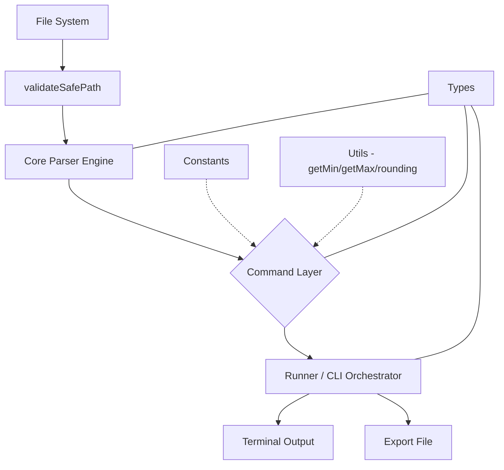

# Technical Reference

This document describes the internal machinery of `@luicciandev/drillhole-cli`. It is intended for developers maintaining or extending the tool, covering all source modules, their contracts, and their interactions.

## Module Index

| Module | Layer | Responsibility |
|---|---|---|
| `bin/drill.js` | Entrypoint | Shebang wrapper, imports compiled router |
| `src/index.ts` | Router | Parse argv, detect operation, dispatch to interactive or non-interactive |
| `src/runner.ts` | Runner | Non-interactive orchestrator, flag validation, command dispatch |
| `src/cli/index.ts` | UI | Interactive menus via `@clack/prompts` |
| `src/cli/banner.ts` | UI | Animated ASCII banner via `figlet` |
| `src/commands/collar.ts` | Command | Spatial boundary limits with directional rounding |
| `src/commands/assay.ts` | Command | Percentile-based grade analysis |
| `src/commands/litho.ts` | Command | Unique lithological code extraction |
| `src/commands/audit.ts` | Command | Data quality validation |
| `src/commands/schema.ts` | Command | Vulcan data type inference |
| `src/commands/export.ts` | Command | File writer (CSV/TXT) |
| `src/core/parser.ts` | Core | Secure file I/O, delimiter auto-detection, stream parsing |
| `src/utils/math.ts` | Utility | Pure math functions |
| `src/constants/mining.ts` | Constants | Domain-specific column maps and skip lists |
| `src/types/` | Types | Centralized TypeScript interfaces |

## Entrypoint

### `bin/drill.js`

A lightweight wrapper that provides the Node.js shebang and imports the compiled router.

```typescript
#!/usr/bin/env node
import('../dist/index.js');
```

This file is what npm registers as the `drill` command via `"bin": "./bin/drill.js"` in `package.json`. It always imports from `dist/` (compiled output), never from `src/` directly.

**Two execution paths:**

| Path | Command | Source | Use case |
|---|---|---|---|
| Published CLI | `drill` | `bin/drill.js` → `dist/index.js` | After `npm install -g` |
| Local development | `pnpm drill` | `tsx src/index.ts` | During development (hot-reload via tsx) |

## Router (`src/index.ts`)

### Responsibilities

- Parse `process.argv` to detect operation flags
- Dispatch to interactive or non-interactive mode
- Handle `--help`, `--version`, `--no-banner` / `-q`

### Operation Detection

```typescript
const OPERATIONS = ['--audit', '--collar', '--assay', '--litho', '--schema'] as const;
const OP_MAP: Record<string, RunnerOptions['operation']> = {
  '--audit': 'audit',
  '--collar': 'collar',
  '--assay': 'assay',
  '--litho': 'litho',
  '--schema': 'schema',
};
```

If no operation flag is found, the interactive mode launches via `runCli()`. Otherwise, flags are parsed into a `RunnerOptions` object and passed to `runNonInteractive()`.

### Base Directory Resolution

```typescript
let dir = process.cwd();
const dirIndex = args.findIndex((a) => a === '--dir' || a === '-d');
if (dirIndex !== -1) {
  const val = args[dirIndex + 1];
  if (val) dir = val;
}
```

If `--dir` is omitted, the current working directory is used.

## Runner (`src/runner.ts`)

### Responsibilities

- Validate that `--dir` and `--file` exist
- Resolve file paths relative to `--dir`
- Call the correct `runX()` function based on operation
- Optionally export results via `exportData()` when `--format` is set

### Dispatch Structure

```typescript
switch (operation) {
  case 'audit':   return runAudit(filePath);
  case 'collar':  return runCollar(filePath, { baseDir, buffer });
  case 'assay':   return runAssay(filePath, { cols, classes, baseDir });
  case 'litho':   return runLitho(filePath, { cols, baseDir });
  case 'schema':  return runSchema(filePath, { baseDir });
}
```

### Export Flow

When `--format csv` or `--format txt` is specified, the runner calls `exportData(result, label, format, outdir)` which writes files to `./exports/` (or the path specified by `--outdir`).

## Interactive CLI (`src/cli/index.ts`)

### Responsibilities

- Display animated ASCII banner (unless `noBanner: true`)
- Guide the user through operation selection, file selection, and option configuration via `@clack/prompts`
- Construct a `CliOptions` object and call command logic

### Menu Flow

1. **Operation selection**: Choose from audit, collar, assay, litho, schema
2. **File selection**: List `.csv` / `.txt` files from the target directory
3. **Operation-specific options**: Buffer (collar), classes/columns (assay), columns (litho)
4. **Output format**: Table output, CSV, TXT, or none
5. Execute command and display result

### Key Types

```typescript
interface CliOptions {
  baseDir?: string;
  output?: 'table' | 'csv' | 'txt' | 'none';
  buffer?: string;
  cols?: string[];
  classes?: string;
}
```

## Command Layer (`src/commands/`)

### Standard Pattern

Every command module exports three things:

| Export | Signature | Purpose |
|---|---|---|
| `runX()` | `(filePath: string, opts: Options) => Result` | Pure logic, returns structured data |
| `printX()` | `(result: Result) => void` | Formats and prints result to stdout |
| `default` | `(filePath: string, opts: Options) => Promise<void>` | CLI bridge: calls run → print → optionally export |

### Collar (`collar.ts`)

**Input:** Coordinate columns (EASTING, NORTHING, ELEVATION, LENGTH)

**Output:** Spatial boundary limits with directional rounding.

**Key logic:**
- Maps input columns using `COLLAR_COLUMN_MAP` priority mappings
- Easting/Northing: `floorTo(min, 100)` and `ceilTo(max, 100)`
- Elevation: `floorTo(min - maxLength, 10)` and `ceilTo(max, 10)`
- Optional buffer expands boundaries outward

**Rounding rules:**

| Coordinate | Unit | Min boundary | Max boundary |
|---|---|---|---|
| EASTING | 100 | `floor(raw_min)` | `ceil(raw_max)` |
| NORTHING | 100 | `floor(raw_min)` | `ceil(raw_max)` |
| ELEVATION | 10 | `floor(raw_min - max_length)` | `ceil(raw_max)` |

### Assay (`assay.ts`)

**Input:** Numeric columns (auto-detected or user-specified via `--cols`)

**Output:** Percentile-based grade ranges split into N classes (default 6).

**Key logic:**
- Skips non-numeric columns defined in `ASSAY_SKIP_COLUMNS`
- Uses `parseColumns` with `targetColumns` for memory efficiency
- Divides value range into N equal-width percentile classes
- Each class reports: class number, min, max, percentile boundaries

### Litho (`litho.ts`)

**Input:** Categorical columns (specified via `--cols`)

**Output:** Unique sorted values per column.

**Key logic:**
- Collects all values from specified columns
- Deduplicates and sorts alphabetically
- Supports multiple columns (each column is analyzed independently)

### Audit (`audit.ts`)

**Input:** Entire file

**Output:** Data quality statistics.

**Key logic:**
- Counts total rows and columns
- Detects null values per column
- Identifies numeric vs text columns
- Reports decimal formatting consistency

### Schema (`schema.ts`)

**Input:** Entire file (sample up to 500 rows)

**Output:** Vulcan-compatible data type per column.

**Type mapping:**

| Detected type | Vulcan type | Criteria |
|---|---|---|
| `integer` | `INT` | Whole numbers only |
| `single` | `SNG` | Decimal numbers ≤ 10 characters |
| `double` | `DBL` | Decimal numbers > 10 characters |
| `text` | `TXT` | Non-numeric values |

### Export (`export.ts`)

**Input:** Structured data, name, format, optional output directory

**Output:** File path(s) to written files.

**Export format by operation:**

| Operation | TXT format | CSV format |
|---|---|---|
| `collar_limits` | Pretty-printed JSON | Table: Coord, Raw_Min, Raw_Max, Min_Boundary, Max_Boundary |
| `assay_limits` | Pretty-printed JSON | One file per column: Clase, From, To, Percentil_From, Percentil_To |
| `litho_values` | Pretty-printed JSON | Rows: Column, Value |
| `audit_results` | Pretty-printed JSON | N/A |
| `schema_types` | Pretty-printed JSON | N/A |

**Output location:**
```typescript
const dir = path.resolve(outdir ?? path.join(process.cwd(), 'exports'));
```

If `--outdir` is not specified, files are written to `./exports/` relative to the current working directory. The directory is created automatically if it does not exist.

## Core Parser (`src/core/parser.ts`)

### `validateSafePath(filepath, baseDir?)`

Resolves and validates file access.

```typescript
export function validateSafePath(filepath: string, baseDir?: string): string {
  const root = path.resolve(baseDir ?? process.cwd());
  const resolved = path.resolve(root, filepath);
  if (!resolved.startsWith(root)) {
    throw new Error(`Acceso denegado: ...`);
  }
  const ext = path.extname(resolved).toLowerCase();
  if (ext !== '.csv' && ext !== '.txt') {
    throw new Error('Solo se permiten archivos .csv o .txt');
  }
  return resolved;
}
```

### `parseFile(filepath, baseDir?)`

Reads a file and returns an array of typed row objects. Uses Node.js Readline interface over a file stream. Each row is parsed as a `Record<string, string>` using the header row as keys.

**Type constraint:** `T extends Record<string, string>`.

**Resource management:** Uses `try...finally` to guarantee stream and readline closure.

### `parseColumns(filepath, maxRows?, targetColumns?, baseDir?)`

Parses data into a column-oriented structure.

**Parameters:**

| Parameter | Type | Default | Description |
|---|---|---|---|
| `filepath` | `string` | — | Path to the file |
| `maxRows` | `number` | `Infinity` | Maximum rows to read (supports early exit) |
| `targetColumns` | `string[]` | all columns | Only retain these columns in memory |
| `baseDir` | `string` | `process.cwd()` | Base directory for security validation |

**Optimization:**
- When `targetColumns` is provided, only those columns are stored in memory — all others are discarded during parsing
- When `maxRows` is finite, the stream is destroyed early to avoid reading unnecessary data

### `getFilesInDir(dir?)`

Lists `.csv` and `.txt` files in a directory. Also validates directory access against the base directory.

## Utility Layer (`src/utils/math.ts`)

### Functions

| Function | Signature | Description |
|---|---|---|
| `floorTo` | `(value: number, unit: number) => number` | Round down to nearest `unit` |
| `ceilTo` | `(value: number, unit: number) => number` | Round up to nearest `unit` |
| `percentile` | `(arr: number[], p: number) => number` | Linear interpolation percentile |
| `getMin` | `(arr: number[]) => number` | Stack-safe minimum (iterative) |
| `getMax` | `(arr: number[]) => number` | Stack-safe maximum (iterative) |

**Stack safety:** `getMin` and `getMax` use iterative loops instead of spread syntax (`Math.min(...arr)`) to avoid `RangeError: Maximum call stack size exceeded` on large arrays (>65,536 elements).

## Constants Layer (`src/constants/mining.ts`)

### `COLLAR_COLUMN_MAP`

Priority mappings for coordinate column identification:

```typescript
const COLLAR_COLUMN_MAP: Record<string, string> = {
  X: 'EASTING',    EASTING: 'EASTING',
  Y: 'NORTHING',   NORTHING: 'NORTHING',
  Z: 'ELEVATION',  ELEVATION: 'ELEVATION',
  LENGTH: 'LENGTH',
};
```

### `ASSAY_SKIP_COLUMNS`

Columns excluded from numeric analysis in assay:

```
HOLE_ID, HOLEID, DEPTH, FROM, TO, LENGTH, AZIMUTH, DIP, DATE, TYPE, ...
```

## Types Layer (`src/types/`)

### `parser.ts`

| Type | Description |
|---|---|
| `ParseResult<T>` | Generic structure for row-based data |
| `ColumnResult<T>` | Generic structure for column-oriented data |
| `Delimiter` | Union type: `',' \| '\t'` |

### `commands.ts`

| Type | Description |
|---|---|
| `VulcanDataType` | `'integer' \| 'single' \| 'double' \| 'text'` |
| `CollarResult` | Strictly typed result with mapped keys `'E' \| 'N' \| 'Z' \| 'L'` |
| `AssayResult` | Array of percentile range objects per column |
| `LithoResult` | Map of column name to unique sorted values |
| `AuditResult` | Row count, column stats, null detection |
| `SchemaResult` | Column-to-type mapping |

## Data Flow Diagram


