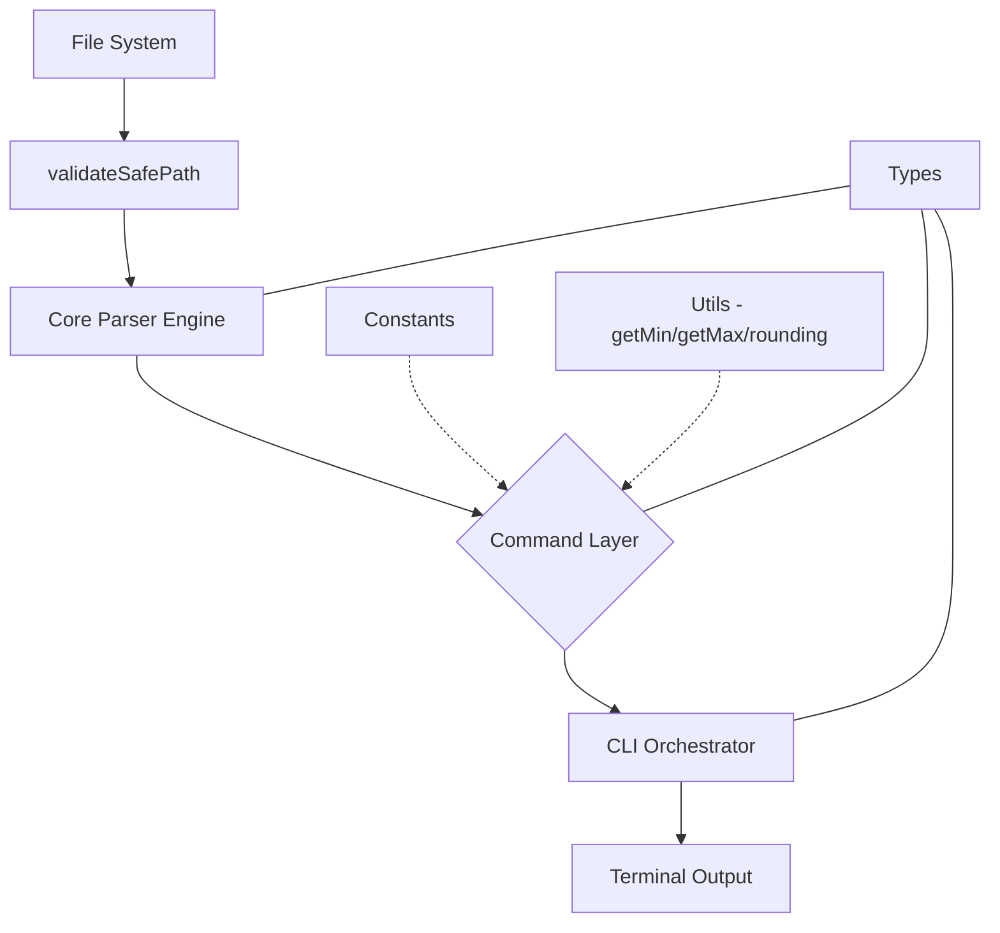

# Technical Reference: drillhole-cli Internals

This document provides a technical description of the `drillhole-cli` machinery. It is intended for developers maintaining or extending the tool, focusing on its modular architecture, security policies, performance optimizations, and type-safe implementation.

## CLI Usage

The CLI supports the following arguments for flexible data ingestion:

- `pnpm drill`: Runs in the current directory.
- `pnpm drill --dir <path>` or `pnpm drill -d <path>`: Runs in the specified directory.
- `pnpm drill --help` or `pnpm drill -h`: Displays this help message.

---

## Architecture Overview

The project follows a **Clean Architecture** pattern, strictly separating concerns into specialized layers to ensure scalability and maintainability.

- **Types Layer (`src/types/`)**: The single source of truth for all data structures and generic constraints.
- **Utility Layer (`src/utils/`)**: Pure, reusable functions for domain-agnostic logic (math, formatting).
- **Constants Layer (`src/constants/`)**: Domain-specific business rules and configuration.
- **Core Layer (`src/core/`)**: High-performance and secure data ingestion engine.
- **Command Layer (`src/commands/`)**: Modular implementations of mining-specific operations.
- **CLI Layer (`src/cli/`)**: User interface orchestration and visual feedback.

---

## Development Standards & TypeScript Configuration

To ensure maximum safety and maintainability, the project enforces strict TypeScript rules in `tsconfig.json`:

- `"strict": true`: Full type safety.
- `"noUncheckedIndexedAccess": true`: Enforces safety checks when accessing object properties or array indices, preventing undefined-related runtime errors.
- `"isolatedModules": true`: Ensures compatibility with modern fast transpilers.
- `"verbatimModuleSyntax": true`: Enforces explicit type-only imports (`import type`), crucial for ESM compatibility.
- `"sourceMap": true`: Enables direct debugging of TypeScript source code.

---

## Types Layer (`src/types/`)

All interfaces are centralized to avoid circular dependencies and ensure consistency.

### `parser.ts`
Defines the structure of raw data ingestion.
- `ParseResult<T>`: Generic structure for row-based data.
- `ColumnResult<T>`: Generic structure for column-oriented data.
- `Delimiter`: Union type `',' | '\t'`.

### `commands.ts`
Defines contracts for CLI operations.
- `VulcanDataType`: Literal union for schema inference (`'integer' | 'single' | 'double' | 'text'`).
- `CollarResult`: Strictly typed result map including an `_headers` property with mapped keys `'E' | 'N' | 'Z' | 'L'`.

---

## The Generic Parser Engine (`src/core/`)

The core engine is optimized for performance and security using Node.js Streams, Readline interfaces, and active path sanitization.

### `parser.ts`

#### `validateSafePath(filepath)`
Resolves and validates filepaths to mitigate security vulnerabilities.
- **Path Traversal Protection**: Ensures the target path lies strictly inside the current working directory (`process.cwd()`).
- **File Extension Whitelisting**: Limits file ingestion strictly to `.csv` and `.txt` extensions.

#### `parseFile<T>(filepath)`
Reads a file and returns an array of typed row objects.
- **Constraint**: `T extends Record<string, string>`.
- **Resource Management**: Uses a `try...finally` block to guarantee that the `Readline` interface and file streams are closed, preventing file descriptor leaks.

#### `parseColumns<T>(filepath, maxRows?, targetColumns?)`
Parses data into a column-oriented structure.
- **Lazy Parsing Optimization**: Accepts an optional `targetColumns` array. If supplied, only the values belonging to those specific columns are retained in memory. All other columns are discarded on the fly, drastically reducing memory footprint when processing wide tables.
- **Early Exit**: Can stop early if `maxRows` is provided.
- **Resource Management**: Ensures file streams and interfaces are closed securely via `try...finally`.

---

## Command Execution Layer (`src/commands/`)

Each command follows a standard pattern: a `runX` function for logic and a default export for the CLI bridge.

### Standard Pattern
1.  **Input**: Receives a file path and a typed `Options` object.
2.  **Validation**: Validates the path using `validateSafePath`.
3.  **Processing**: Fetches data via `parseColumns` or `parseFile`. For high performance, commands request only required columns (e.g. coordinates in `collar`).
4.  **Transformation**: Applies mining logic using `src/utils/math.ts`, ensuring safe handling of potentially undefined values as mandated by `noUncheckedIndexedAccess`.
5.  **Result**: Returns a strictly typed `Result` object.

### Key Modules
- **`collar.ts`**: Calls `parseColumns` requesting only the coordinate-mapping columns from `COLLAR_COLUMN_MAP`. Resolves coordinate limits using stack-safe min/max utilities.
- **`assay.ts`**: Performs percentile-based binning for grade distribution, using lazy-column parsing when specific columns are defined by the user.
- **`schema.ts`**: Infers Vulcan-compatible data types based on value analysis.

---

## Utility & Constant Reference

### `src/utils/math.ts`
- **`floorTo` / `ceilTo`**: Directional rounding to a specific unit.
- **`percentile`**: Linear interpolation algorithm for precise binning, safe against `undefined` indices.
- **`getMin` / `getMax`**: **Stack-safe** min/max calculations. Unlike native `Math.min(...arr)` which triggers `RangeError: Maximum call stack size exceeded` on arrays larger than 65,535 items, these functions evaluate values iteratively using simple loops, making them suitable for massive mining datasets.

### `src/constants/mining.ts`
- **`COLLAR_COLUMN_MAP`**: Priorities for coordinate identification (e.g., `X` -> `EASTING`).
- **`ASSAY_SKIP_COLUMNS`**: Default blacklist for non-numeric assay analysis.

---

## Visual Orchestration (`src/cli/`)

### Animated Banner (`banner.ts`)
The `printBanner` function implements a "typewriter" effect using ANSI escape sequences:
1.  **Construction**: Iteratively slices the word `DRILLHOLE`.
2.  **Redrawing**: Uses `\x1b[nA` to move the cursor up and `\r\x1b[K` to clear lines, allowing in-place animation.
3.  **Timing**: Managed via a local `sleep` utility for consistent frames.

---

## Data Flow Diagram

