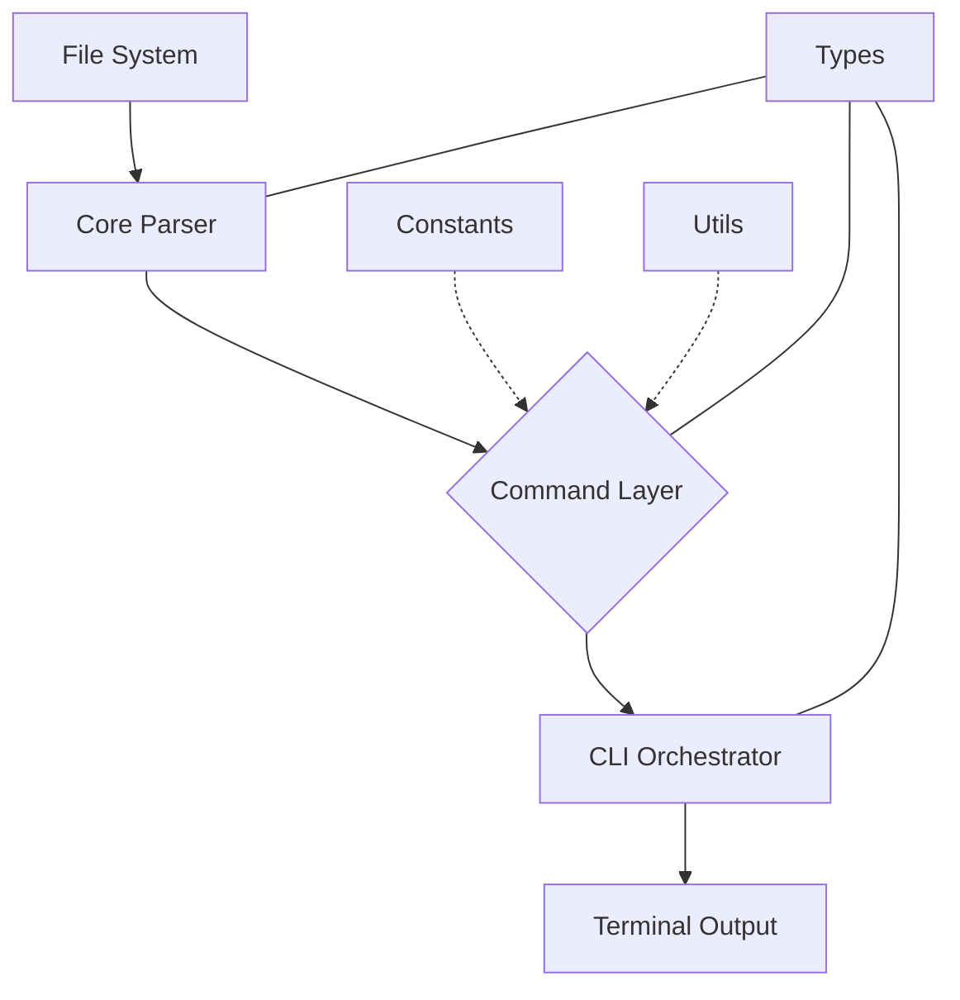

# Technical Reference: drillhole-cli Internals

This document provides a technical description of the `drillhole-cli` machinery. It is intended for developers maintaining or extending the tool, focusing on its modular architecture and type-safe implementation.

## CLI Usage

The CLI supports the following arguments for flexible data ingestion:

- `pnpm drill`: Runs in the current directory.
- `pnpm drill --dir <path>` or `pnpm drill -d <path>`: Runs in the specified directory.
- `pnpm drill --help` or `pnpm drill -h`: Displays this help message.

---

## Architecture Overview

The project follows a **Clean Architecture** pattern, strictly separating concerns into specialized layers to ensure scalability and maintainability.

- **Types Layer (`src/types/`)**: The single source of truth for all data structures and generic constraints.
- **Utility Layer (`src/utils/`)**: Pure, reusable functions for domain-agnostic logic (math, formatting).
- **Constants Layer (`src/constants/`)**: Domain-specific business rules and configuration.
- **Core Layer (`src/core/`)**: High-performance data ingestion engine.
- **Command Layer (`src/commands/`)**: Modular implementations of mining-specific operations.
- **CLI Layer (`src/cli/`)**: User interface orchestration and visual feedback.

---

## Development Standards & TypeScript Configuration

To ensure maximum safety and maintainability, the project enforces strict TypeScript rules in `tsconfig.json`:

- `"strict": true`: Full type safety.
- `"noUncheckedIndexedAccess": true`: Enforces safety checks when accessing object properties or array indices, preventing undefined-related runtime errors.
- `"isolatedModules": true`: Ensures compatibility with modern fast transpilers.
- `"verbatimModuleSyntax": true`: Enforces explicit type-only imports (`import type`), crucial for ESM compatibility.
- `"sourceMap": true`: Enables direct debugging of TypeScript source code.

---

## Types Layer (`src/types/`)

All interfaces are centralized to avoid circular dependencies and ensure consistency.

### `parser.ts`
Defines the structure of raw data ingestion.
- `ParseResult<T>`: Generic structure for row-based data.
- `ColumnResult<T>`: Generic structure for column-oriented data.
- `Delimiter`: Union type `',' | '\t'`.

### `commands.ts`
Defines contracts for CLI operations.
- `VulcanDataType`: Literal union for schema inference (`'integer' | 'single' | 'double' | 'text'`).
- `CollarResult`: Strictly typed result map including an `_headers` property with mapped keys `'E' | 'N' | 'Z' | 'L'`.

---

## The Generic Parser Engine (`src/core/`)

The core engine is optimized for performance using Node.js Streams and Readline interfaces.

### `parser.ts`

#### `parseFile<T>(filepath)`
Reads a file and returns an array of typed row objects.
- **Constraint**: `T extends Record<string, string>`.
- **Behavior**: Auto-detects delimiters and trims whitespace from headers and values.

#### `parseColumns<T>(filepath, maxRows?)`
Parses data into a column-oriented structure, ideal for statistical analysis.
- **Optimization**: Can stop early if `maxRows` is provided (used for schema sampling).
- **Structure**: `columns` is a `Record<keyof T, string[]>`.

---

## Command Execution Layer (`src/commands/`)

Each command follows a standard pattern: a `runX` function for logic and a default export for the CLI bridge.

### Standard Pattern
1.  **Input**: Receives a file path and a typed `Options` object.
2.  **Processing**: Fetches data via `parseColumns` or `parseFile`.
3.  **Transformation**: Applies mining logic using `src/utils/math.ts`, ensuring safe handling of potentially undefined values as mandated by `noUncheckedIndexedAccess`.
4.  **Result**: Returns a strictly typed `Result` object.

### Key Modules
- **`collar.ts`**: Uses `COLLAR_COLUMN_MAP` from constants to identify coordinates and applies directional rounding.
- **`assay.ts`**: Implements percentile-based binning for grade distribution.
- **`schema.ts`**: Infers Vulcan-compatible data types based on value analysis.

---

## Utility & Constant Reference

### `src/utils/math.ts`
- **`floorTo` / `ceilTo`**: Directional rounding to a specific unit.
- **`percentile`**: Linear interpolation algorithm for precise binning, safe against `undefined` indices.

### `src/constants/mining.ts`
- **`COLLAR_COLUMN_MAP`**: Priorities for coordinate identification (e.g., `X` -> `EASTING`).
- **`ASSAY_SKIP_COLUMNS`**: Default blacklist for non-numeric assay analysis.

---

## Visual Orchestration (`src/cli/`)

### Animated Banner (`banner.ts`)
The `printBanner` function implements a "typewriter" effect using ANSI escape sequences:
1.  **Construction**: Iteratively slices the word `DRILLHOLE`.
2.  **Redrawing**: Uses `\x1b[nA` to move the cursor up and `\r\x1b[K` to clear lines, allowing in-place animation.
3.  **Timing**: Managed via a local `sleep` utility for consistent frames.

---

## Data Flow Diagram

